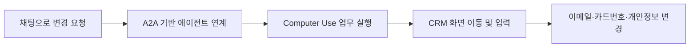

# AICC 업무 자동화 에이전트

채팅으로 받은 요청을 CRM 화면에서 실행하는 Computer Use 기능을 개발했습니다. 사내 개발자 및 인도 X사와 함께 진행한 AICC 업무 자동화 프로젝트이며, **Azure 환경에서 PoC 시연**까지 수행했습니다.

**기간:** 2025.04–2025.07  
**형태:** 공동 개발  
**담당:** CRM 정보 변경을 수행하는 Computer Use 기능 개발  
**상태:** PoC 개발 및 시연

## 맡은 기능

Google A2A 프로토콜을 기반으로 에이전트가 연계되는 구조에서, 채팅 요청을 실제 CRM 화면의 작업으로 연결하는 영역을 맡았습니다.

- CRM 사이트에 접속해 필요한 업무 화면으로 이동
- 이메일 변경
- 카드번호 변경
- 개인정보 변경

전체 프로젝트는 음성·채팅 기반 업무 자동화를 다뤘으며, 이 사례에서는 제가 구현한 **채팅 요청에 따른 CRM 화면 조작**을 중심으로 설명합니다.

## 처리 흐름

CRM에서 수행할 작업을 화면 이동과 입력 단계로 나누고, 실행 환경에서 해당 동작을 처리하도록 구현했습니다. 개발 과정에서 WebSocket 통신, 화면 요소 확인, 클릭·입력·키 조작, 작업 전후 스크린샷 비교를 통한 단계별 검증을 다뤘습니다.

## 기술 경험

| 영역 | 적용 내용 |
| --- | --- |
| 에이전트 연계 | Google A2A 프로토콜 기반 구조 |
| 업무 실행 | Computer Use를 통한 CRM 화면 조작 |
| 실행 환경 통신 | WebSocket 기반 요청·응답 |
| 실행 확인 | 화면 요소 확인 및 스크린샷 기반 단계별 검증 |
| 시연 환경 | Azure |

## 결과

채팅에서 시작한 정보 변경 요청을 CRM 화면에서 실행하는 시나리오를 구현하고, Azure 환경에서 PoC 시연을 진행했습니다.

[프로필로 돌아가기](../README.md)
